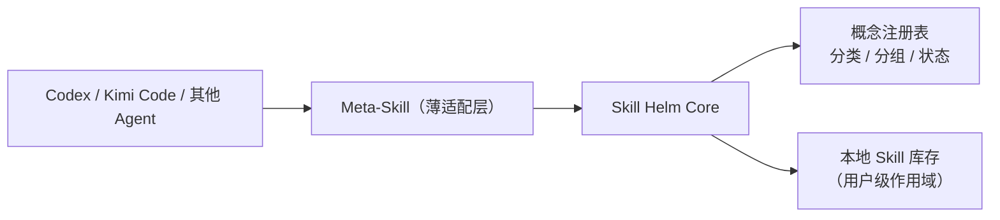

# Skill Helm

面向 Codex、Kimi Code 与其他支持 Agent Skills 的客户端的、Agent 无关的 Skill 管理平台。

> 当前状态：产品定义阶段。本文档描述的是目标架构与功能边界，不代表已实现的功能。

## 解决什么问题

常用多个 coding agent（如 Codex、Kimi Code）的用户，Skill 分散在各 Agent 自己的目录里；随着数量增长，会频繁需要新增、维护、删除、禁用、分类、分组。已有方案大多是「外部工具管 Skill」——独立的桌面应用、CLI 包管理器或云端注册表——Skill 的创建和维护要离开对话上下文。

Skill Helm 换一个方向：**平台本身作为一个 Meta-Skill 注册进各 Agent**，在对话里直接提供新增、更新 Skill 的元能力；同时用一个与 Agent 无关的核心集中维护 Skill 的概念、分类与状态。



各 Agent 只安装薄适配层（Meta-Skill）；真正的创建、更新、禁用、分类逻辑都在 Core 里，不随 Agent 聊天记录丢失。

## 核心概念

- **Meta-Skill**：注册进每个 Agent 的管理入口。在对话中让 Agent 新增、更新、查看 Skill，无需离开会话。
- **概念注册表**：集中维护「生成 Skill 的核心概念」——Skill 的 anatomy、frontmatter 约定、触发描述写法等，是平台生成和审核 Skill 的事实来源。
- **统一管理面**：查看、删除、禁用、分类、分组。禁用不删除文件，只是从 Agent 的发现路径中摘除。
- **用户级作用域**：Skill 默认注册到用户级域（如 `~/.agents/skills`），对所有项目全局生效；项目级注册作为可选能力。
- **本地优先**：状态保存在本地文件，不把聊天记录当作唯一存储。

## 与现有方案的区别

| 项目 | 形态 | 与 Skill Helm 的差异 |
|---|---|---|
| [mode-io/skill-manager](https://github.com/mode-io/skill-manager) | 独立本地 app | 外部管理器，无 Agent 内驻 Meta-Skill；不支持 Kimi Code |
| [yibie/skills-manager](https://github.com/yibie/skills-manager) | macOS app + TUI | 外部管理器，无概念注册表 |
| [vercel-labs/skills](https://github.com/vercel-labs/skills) (`npx skills`) | 包管理器 CLI | 只负责安装/删除，无禁用、分类、分组管理 |
| [Portkey Skills Registry](https://portkey.ai/blog/skills-registry/) | 云端团队注册表 | 面向团队分发，非本地个人管理 |
| 各类 Marketplace（LobeHub 等） | 发现与分发 | 不做本地生命周期管理 |

## 快速开始

需要 Node.js 22+ 与 pnpm 10+：

```powershell
pnpm install
pnpm build
pnpm test
# 初始化库存（~/.skill-helm），并把 meta-skill 启用到所有已检测到的 Agent
node packages/cli/dist/cli.js init
# 把 skill-helm 命令挂到 PATH（推荐，meta-skill 依赖它）
pnpm --dir packages/cli link --global
```

桌面端（Tauri，需要 Rust 1.84+）：

```powershell
pnpm --dir apps/desktop desktop:dev     # 开发模式（自动拉起 skill-helm serve sidecar）
pnpm --dir apps/desktop desktop:build   # 打包 NSIS 安装包
```

桌面端带自动更新：启动时检查一次、此后每 30 分钟轮询 GitHub Releases 的 `latest.json`，发现新版本会在右下角弹出常驻 toast，点击「立即更新」即下载安装（NSIS 安装器接管并自动重启到新版本）。发布侧由 `.github/workflows/release.yml` 完成——打包时用 `TAURI_SIGNING_PRIVATE_KEY`（仓库 Secret，对应公钥已写死在 `tauri.conf.json`）为更新包签名，并生成 `latest.json` 一并上传。注意：丢失私钥意味着无法再签发更新，需要换公钥并强制所有用户重装。

常用命令（全部支持 `--json`）：

```powershell
skill-helm list                          # 查看库存
skill-helm create my-skill --description "什么时候用这个 skill"
skill-helm adopt ~/.codex/skills/xxx     # 收编散落在 Agent 目录里的 Skill
skill-helm enable my-skill --to codex,kimi-code
skill-helm disable my-skill --from codex # 只摘联接，不删文件
skill-helm doctor                        # 一致性检查
skill-helm search "视频字幕"              # 按描述在 GitHub 搜 Skill 仓库
skill-helm install owner/repo --skill xx # 安装进库存，enable 即试用
skill-helm history init <空目录>          # 可选：开启变更历史记录
skill-helm eval env                      # 检测本地 Codex 与 skill-up
skill-helm eval run my-skill              # 生成用例并执行有无 Skill 对照评测
skill-helm eval run --all --enabled-only  # 串行批量评估全部已启用 Skill
```

## Skill 行为评估

桌面端「我的技能」支持评估所选、评估全部和仅已启用范围。评估分为两步：先生成并审核 `evals/` 用例，再由本地 Codex 通过 [skill-up](https://github.com/alibaba/skill-up) 串行执行。每个用例同时运行有无 Skill 两组，报告展示通过率、提升幅度、失败原因与对照输出；支持取消、失败重试和 Markdown 汇总导出。

运行前需要本地 Codex CLI 已登录，并将 `skill-up` 安装到 `PATH`。语义裁判读取 Codex 的 `model` / `model_provider`，也可用 `SKILL_HELM_CODEX_MODEL` 与 `SKILL_HELM_CODEX_PROVIDER` 覆盖。评测任务、日志和 HTML/JSON 报告保存在 `~/.skill-helm/evals/runs/`，不会把运行产物写进 Skill 源目录。已有自定义 `evals/` 可直接执行，但不能被可视化编辑器覆盖。

## 里程碑

- M0 ✅ 统一库存 + CLI + Meta-Skill 自举
- M1 ✅ 概念注册表完善 + lint 规则
- M2 ✅ 可选持久化接口（[issue #1](https://github.com/coconilu/skill-helm/issues/1)）
- M3 ✅ 市场搜索（[issue #2](https://github.com/coconilu/skill-helm/issues/2)）
- M4 ✅ Tauri 桌面端可视化管理
- M5 ✅ 本地 Codex + skill-up 单个/批量行为评估与对照报告

## 仓库结构

```text
packages/core/            Skill 模型、库存、注册表、启用/禁用、lint、doctor、市场
packages/cli/             面向用户和 Agent 的 CLI（--json 输出），含 serve HTTP API
apps/desktop/             Tauri 桌面端（React 仪表盘 + sidecar 生命周期）
meta-skill/               注册进各 Agent 的 Meta-Skill 定义
adapters/*.json           Agent 薄适配层（只有 skills 目录声明）
concepts/                 概念注册表（生成 Skill 的事实来源）
docs/                     产品与架构文档
```

## 公开仓库安全规则

- 永不提交真实的用户 Skill 内容、本地路径中的隐私信息或任何凭据。
- 示例中的路径与配置一律使用占位符。

## 许可证

MIT。各 Agent 平台与其 Skill 格式仍受各自条款约束。
